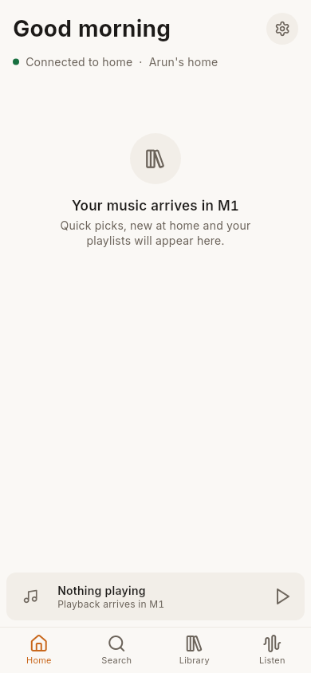
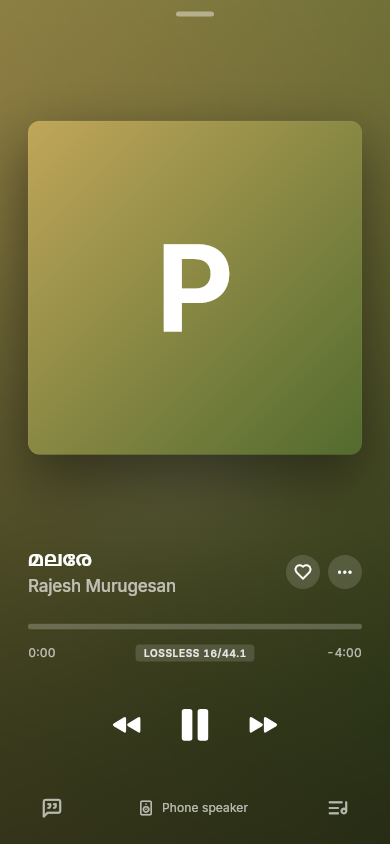
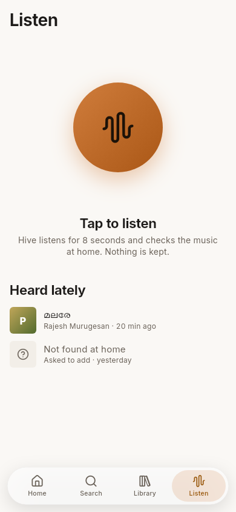

# Hive

**Your family's music, from your own computer at home.** Hive plays the
music you own (FLAC, MP3, AAC, ALAC…) from one computer at home to every
phone and computer in the family, in full quality, with no subscription and
nothing uploaded to anyone. It's free software (AGPL-3.0); every feature is
free.

<p>
  
  
  
</p>

- **Lossless and hi-res**, gapless, with volume levelling and an honest badge for what reaches your ears
- **Your music, well kept:** covers, film soundtracks, credits and lyrics, in Malayalam, Hindi, Tamil, English and more, side by side
- **Downloads** that play offline for 30 days
- **Listen:** hold the phone to a speaker and Hive names the song from your own collection (only sound landmarks reach home, never the recording)
- **Carry on** from another device, or use your phone as the remote
- **Simple mode** with big buttons, for grandparents
- **Private by design:** invite-only, every device approved, reachable only over your own private network ([Tailscale](https://tailscale.com)); see [PRIVACY.md](PRIVACY.md)
- **Backups** every night, and moving Hive to a new computer in minutes

## Run it for your family

You need a computer that stays on at home (Windows, Mac or Linux, or Docker),
your music on it, and Tailscale on it and on the family's devices.

**→ [docs/self-hosting.md](docs/self-hosting.md)**: install the server, set up
the first admin, invite the family, install the apps.

| On | Get |
| --- | --- |
| Windows home computer | `HiveServerSetup-<version>.exe` from [Releases](../../releases) |
| Mac home computer | `HiveServer-<version>-mac.pkg` from Releases |
| Linux / NAS | Docker (`deploy/docker/compose.yml`) or a systemd service |
| Android | `Hive-<version>.apk` from Releases (F-Droid: coming) |
| Windows / Mac apps | `HiveSetup-<version>.exe`, `Hive-<version>-mac.dmg` from Releases |
| iPhone / iPad | build it yourself with your own Apple account (see the guide) |

## What's in this repository

| Folder | What it is |
| --- | --- |
| [`api/`](api/openapi.yaml) | The API contract: every endpoint, and the milestone that built it |
| [`server/`](server/README.md) | The home server (Python, FastAPI, SQLite) |
| [`admin/`](admin/) | Hive Admin, the web panel the server hosts at `/admin` (React) |
| [`app/`](app/) | The app for Android, iOS, Windows and macOS (Flutter) |
| [`deploy/`](deploy/) | Installers (Windows, Mac), Docker and Linux service files |
| [`design/`](design/) | Design tokens and the icon map; the source for both apps' styles |
| [`tools/`](tools/) | Generators for tokens, icons and the API clients; release helpers |
| [`docs/`](docs/) | Guides |

The server is checked against `api/openapi.yaml` in its tests, and the app and
admin clients are generated from it, so the three can't drift apart.

## Developing

[docs/dev-setup.md](docs/dev-setup.md) runs everything from the code:

```sh
cd server && python3 -m venv .venv && .venv/bin/pip install -e ".[dev]" && .venv/bin/python -m hive serve
cd admin && npm ci && npm run build      # Hive Admin, served at /admin
cd app && flutter run                    # macOS, an Android phone or an iPhone
```

Contributions are welcome: [CONTRIBUTING.md](CONTRIBUTING.md). Security
problems: [SECURITY.md](SECURITY.md).

## Licence

[AGPL-3.0](LICENSE). Fonts are under the SIL Open Font License and icons
(Lucide) under the ISC licence; their licences sit beside them in
`app/assets/fonts/`.
